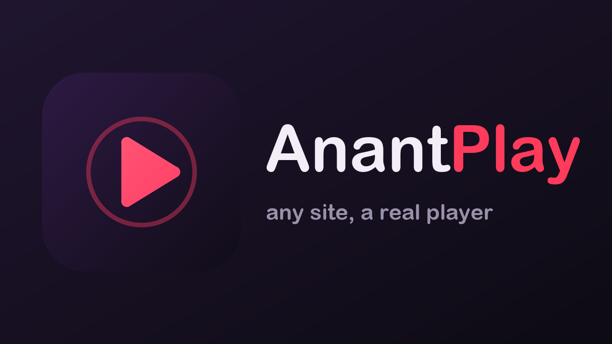
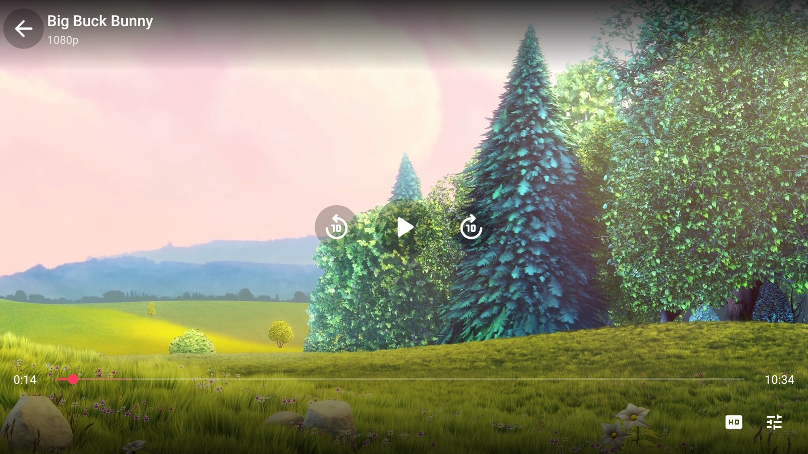

<p align="center">
  
</p>

<p align="center">
  <b>Any streaming site, a real player.</b><br>
  A TV-first Android app that opens the sites you choose, finds the video they play, and plays it in a native player.
</p>

<p align="center">
  <a href="https://github.com/AnantPlay/android/releases/latest"></a>
  <a href="https://github.com/AnantPlay/android/actions/workflows/build.yml"></a>
  
  
</p>

<p align="center">
  <a href="https://github.com/AnantPlay/android/releases/latest">Download</a> ·
  <a href="https://anantplay.github.io/android/">Documentation</a> ·
  <a href="https://anantplay.github.io/android/guide.html">User guide</a> ·
  <a href="https://buymeacoffee.com/rohit267">Support</a>
</p>

<p align="center">
  
</p>

## What it does

- Plays the stream a site starts in a hardware-accelerated player, with the site's servers, qualities, episodes and Sub / Dub as player buttons
- Works with a TV remote and with touch; blocks ads and pop-ups
- Resumes where you stopped on any site, skips intros, finds subtitles in any language
- Downloads movies and episodes (HLS and DASH) as seekable MP4 files
- Casts from the phone to a TV (AnantPlay, Chromecast or DLNA); the phone becomes the remote
- IPTV from playlists, Xtream Codes or Stalker portals you add
- Optional in-app Cloudflare WARP, no VPN permission, no root
- Ships with no sites or channels: you add sources in *Settings, Sources*. No account, no analytics

Everything else is in the [user guide](https://anantplay.github.io/android/guide.html).

## Install

From [Releases](https://github.com/AnantPlay/android/releases/latest): `AnantPlay-TV-vX.Y.Z.apk` for Android TV, Google TV, Fire TV and boxes, `AnantPlay-Android-vX.Y.Z.apk` for phones and tablets. Android 8.0 or newer. The app updates itself.

**Fire TV:** turn on developer options (*Settings → My Fire TV → About*, press the device name 7 times), install **Downloader**, allow it under *Developer options → Install unknown apps*, then enter the code **`6664733`**.

Every APK is built from this repository by GitHub Actions; check yours against `SHA256SUMS.txt` in the release.

## Build

```sh
warp/build.sh   # WARP helper (Go, Android NDK)
./build.sh      # Android SDK 34, JDK 17+
```

Details in the [build guide](https://anantplay.github.io/android/build.html).

## Support

AnantPlay is free and made in spare time. If it is useful to you: [Buy me a coffee](https://buymeacoffee.com/rohit267) or [PayPal](https://paypal.me/champdev).

## Legal

AnantPlay is a browser and a media player. It hosts no video and ships no list of streams; the sources you add and what they serve belong to third parties, and what you watch is your responsibility. Components and data sources are listed in [THIRD_PARTY.md](THIRD_PARTY.md).

## License

[MIT](LICENSE)

## Sinhala fork / සිංහල සංස්කරණය

This fork adds Sinhala subtitle rendering, optional addon-first search, and ±100 ms / ±250 ms timing controls. In **Settings → Subtitles → Subtitle Addon URL**, enter your addon’s base URL (not its `manifest.json` URL). Leave it blank to use OpenSubtitles. Select Sinhala in the player’s subtitle search; enable **Auto subtitles** to reuse that preference.

සිංහල උපසිරැසි සඳහා **Settings → Subtitles → Subtitle Addon URL** වෙත ඔබේ addon URL එක ඇතුළත් කරන්න. හිස්ව තැබුවහොත් OpenSubtitles භාවිත වේ. ශ්‍රී ලංකා රූපවාහිනී නාලිකා සඳහා **Settings → Sources → Add an index by link** තෝරන්න.

For the Sri Lanka TV index, paste `https://raw.githubusercontent.com/dictationb1/srilanka-anantplay/main/index.json` into **Settings → Sources → Add an index by link** and accept the desired sources. See [build and signing notes](docs/FORK_WORKFLOW_NOTES.md).
